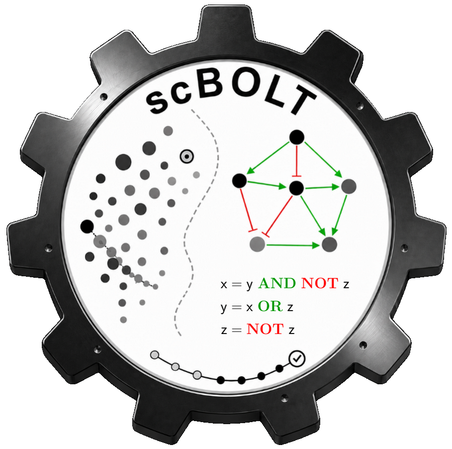
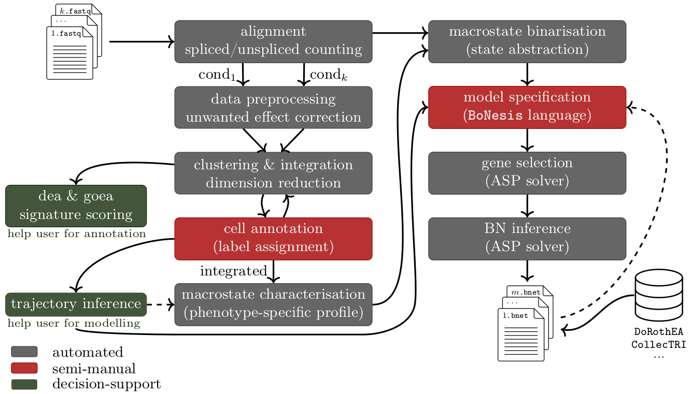

[](https://github.com/bnediction/scbolt/actions/workflows/tests.yml)
[](https://www.gnu.org/software/make)

<br>

# scBOLT

scBOLT is a software framework for inferring Boolean networks from multi-condition single-cell transcriptomic data.

Its main goal is to transform complex transcriptomic observations into biologically meaningful Boolean abstractions and dynamical constraints suitable for exact logical model inference. This remains a major challenge in data-driven logical modeling, particularly for poorly characterized biological systems and non-canonical cellular processes.

scBOLT combines transcriptome-derived state abstractions, user-defined dynamical constraints, and prior regulatory knowledge to generate inference-ready logical models through a reproducible and modular workflow.

### Key features

* multi-condition logical modeling
* transcriptome-driven constraint engineering
* scalable exact Boolean network inference
* multiple macrostate characterisation and binarization strategies
* reusable intermediate entry points
* reproducible execution and dependency management

<p align="center">
  
</p>

# Installation

scBOLT uses a Bash command-line launcher. Native execution is supported on
Linux and requires Bash 4.0 or newer, GNU Make 4.3 or newer, and one environment manager:
[Conda](https://docs.conda.io/),
[Mamba](https://mamba.readthedocs.io/en/latest/installation/mamba-installation.html),
or [Micromamba](https://mamba.readthedocs.io/en/latest/installation/micromamba-installation.html).
Docker is the supported execution backend on macOS and Windows and is also
available on Linux.

Clone the scBOLT release and run the installer:

```sh
git clone --branch v1.0.0 --depth 1 https://github.com/bnediction/scbolt.git
cd scbolt
./install
```

The installer copies an autonomous runtime to `~/.local/lib/scbolt`, installs
the `scbolt` command in `~/.local/bin`, and installs Bash completion. Restart
the shell to enable completion. The source checkout can then be removed.
Install or replace the selected runtime backend explicitly:

```sh
scbolt install conda
scbolt install mamba
scbolt install micromamba
scbolt install docker
```

Initialize a project in any working directory:

```sh
mkdir my_project
cd my_project
scbolt init
```

This creates `scbolt.yml`, `spec.yml`, and the `.scbolt` project locator.
Verify the installation, runtime, and project configuration with:

```sh
scbolt check bn-submin
```

---

## Optional

LaTeX is optional. When available, scBOLT uses it for figure text rendering.
Otherwise, figures are generated with Matplotlib's native text renderer and
plain axis labels such as `UMAP1` and `PC1`.

```sh
apt-get install texlive dvipng texlive-latex-extra texlive-fonts-recommended cm-super texlive-extra-utils
```

The following resources are only required when starting from raw sequencing data:
* [Cell Ranger](https://www.10xgenomics.com/support/software/cell-ranger/downloads) (optional alternative to STAR for alignment and counting)
* Reference genomes and RepeatMasker annotations are downloaded automatically
  for supported organisms when needed.

For long-term reproducibility in raw FASTQ mode, back up the configured `resources-dir`
together with the project. scBOLT does not redistribute large third-party
reference archives.

# Quickstart

A minimal runnable example is available in `quickstart/`. It ships a compact
Boolean macrostate table and signed interaction domain derived from the
Nestorowa hematopoiesis case study, so it requires neither a data download nor
single-cell preprocessing.

See [the quickstart guide](quickstart/README.md) for the commands.

---

# Documentation

The [user manual](man/README.md) documents the public `scbolt` interface.
It begins with the commands required for a first project, then exposes the
individual modules and controls available for advanced workflows.

## First-Time Users

| Start here | Purpose |
| --- | --- |
| [Quickstart](quickstart/README.md) | Run a small complete example without downloading a dataset manually. |
| [User manual](man/README.md) | Learn the project files, generic commands, and recommended execution loop. |
| [Command reference](man/commands.md) | Choose an input route, analytical module, or final inference command. |
| [Project configuration](man/configuration.md) | Configure analyses and Boolean constraints. |

## Going Further

| Guide | Purpose |
| --- | --- |
| [Checking](man/checking.md) | Diagnose target-specific parameters, files, AnnData metadata, runtimes, and commands. |
| [Rebuild controls](man/rebuilds.md) | Recompute or trust selected modules and files. |
| [Output states](man/states.md) | Interpret completed, stale, untracked, and pending outputs. |
| [Solver strategies](man/solver.md) | Configure and interpret large gene-selection problems. |
| [Utilities](man/utilities.md) | Use project inspection, progress, cleaning, and runtime commands. |

Implementation, testing, and contributor documentation live in
[`docs/`](docs/README.md).

---

# Command Line

scBOLT is target-driven: name the result to build, and missing dependencies are
scheduled automatically.

```text
scbolt <module...> [--config=<file>] [--references=<condition...>]
       [--reset-target=<module...>] [--trust-target=<module...>]
       [--trust-existing] [--old-file=<file>...]
       [--<parameter>=<value>...]
```

Discover modules and inspect generated, target-specific help with:

```bash
scbolt help
scbolt <module> help
```

The command-specific help reports outputs, dependencies, effective parameters,
accepted values, and relevant notes.

## First Project

```bash
scbolt init
# Edit scbolt.yml and spec.yml.
scbolt config bn-submin
scbolt check bn-submin
scbolt bn-submin
scbolt progress bn-submin
```

The final command may execute a complete workflow or only its missing final
stages, depending on the configured input route and existing outputs.

## Generic Commands

| Command | Purpose |
| --- | --- |
| `scbolt init` | Create or update the project configuration. |
| `scbolt config [<module>]` | Display effective configuration. |
| `scbolt check <module>` | Validate the selected workflow and runtime. |
| `scbolt dry-run <module>` | Preview the commands that would execute. |
| `scbolt progress [<module...>]` | Report configuration-aware output state. |
| `scbolt clean [<module...>]` | Remove selected generated outputs. |
| `scbolt install <backend>` | Install or replace a runtime backend. |

See [the utilities guide](man/utilities.md) for all modes.

## Input Entry Points

| Available input | Parameter | Workflow starts from |
| --- | --- | --- |
| SRA run accessions | `sra` | FASTQ retrieval, alignment, and counting |
| GEO Sample accessions | `gsm` | Public count-matrix retrieval |
| Local count AnnData files | `count-file` | Filtering |
| Local macrostate AnnData files | `macrostate-file` | Binarization |
| Local binarization CSV | `binarization-file` | Boolean specification |
| Existing scBOLT output files | `old-files` | First missing downstream stage |

Source input routes are mutually exclusive. `old-files` is instead a trust
declaration for files already belonging to the scBOLT workflow. File contracts,
condition-aware forms, and reuse controls are documented in the
[command reference](man/commands.md), [checking guide](man/checking.md), and
[rebuild guide](man/rebuilds.md).

## Common Options

| Option | Description |
| --- | --- |
| `--config=<file>` | Select another public YAML configuration (default: `scbolt.yml`). |
| `--project-dir=<dir>` | Override the generated-output directory (default: `project`). |
| `--resources-dir=<dir>` | Override the external-resource directory (default: `resources`). |
| `--references=<condition...>` | Restrict reference-level execution. |
| `--reset-target=<module...>` | Rebuild from selected modules. |
| `--trust-target=<module...>` | Trust all outputs from selected modules. |
| `--trust-existing` | Trust known DAG outputs already present. |
| `--old-file=<file>` | Trust one existing DAG file. |
| `--<parameter>=<value>` | Override a configuration parameter for one command. |
| `--help` | Display command-specific help. |

`scbolt.yml` is the default project configuration file. Persistent scientific
choices belong there; command-line overrides are temporary.

## Output Layout

Generated files are written below `<project-dir>`:

| Directory | Contents |
| --- | --- |
| `omics/` | Single-cell objects, plots, trajectories, and macrostates |
| `bin/` | Cell and macrostate Boolean abstractions |
| `infer/` | Specifications, selected components, witnesses, and inferred BNs |
| `logs/` | Persisted output from public commands |

By default, these directories are created under `project/`.

---

# Bug reports

Please report any bugs or ask questions [here](https://github.com/bnediction/scbolt/issues) or contact contributors directly.

---

# License

No license currently.

The project is currently intended for internal research use.

---

# Contributors

* Théo Roncalli
* Loïc Paulevé
* Élisabeth Remy
