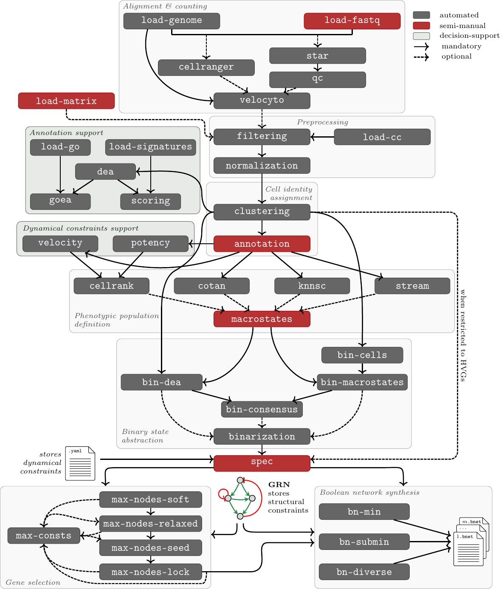

# scBOLT User Manual

scBOLT is a target-driven workflow for inferring Boolean networks from
single-cell transcriptomic data. Users select the result they want, and scBOLT
builds the required upstream modules in dependency order. Users interact with
the workflow through the `scbolt` command, `scbolt.yml`, and `spec.yml`.

This manual starts with the commands common to every project. The complete
pipeline command reference is available in [commands.md](commands.md), while
the other pages describe configuration, validation, solver behavior, and
workflow state in greater depth.

## Documentation Map

| Page | Use it to |
| --- | --- |
| [Installation](../README.md#installation) | Install scBOLT and a supported runtime backend. |
| [Quickstart](../quickstart/README.md) | Run a small complete example distributed with scBOLT. |
| [Command reference](commands.md) | Choose an entry point, pipeline module, or final inference command. |
| [Project configuration](configuration.md) | Configure inputs, methods, conditions, resources, and inference parameters. |
| [Utilities](utilities.md) | Inspect, validate, preview, clean, and install a project runtime. |
| [Checking](checking.md) | Understand `scbolt check` and its target-aware diagnostics. |
| [Rebuild controls](rebuilds.md) | Recompute, trust, or reuse selected workflow outputs. |
| [Output states](states.md) | Interpret `DONE`, `STALE`, `UNTRACKED`, and `PENDING`. |
| [Solver strategies](solver.md) | Understand staged constraint enforcement, clause continuation, and domain continuation. |

Contributor and implementation documentation live in
[`docs/`](../docs/README.md).

## Workflow Model

The main workflow can be read from left to right:

```text
input data
  -> alignment/counting when required
  -> filtering and normalization
  -> clustering and annotation
  -> macrostate characterization
  -> binarization
  -> Boolean specification
  -> gene selection
  -> Boolean network inference
```

Trajectory inference, differential expression, signature scoring, and Gene
Ontology enrichment are analytical branches that support biological decisions.
They are not necessarily part of every path to a Boolean network.

scBOLT is target-driven. Running a downstream command recursively schedules
only the missing upstream outputs required by the active configuration:

```bash
scbolt bn-submin
```

The command above may run a complete workflow or only Boolean network
enumeration. The actual path depends on the selected input route, trusted
outputs, macrostate and binarization methods, and outputs already present.

The module map below shows the public workflow and its configurable branches.

<p align="center">
  <a href="fig/scbolt-modules.pdf">
    
  </a>
</p>

## First-Time Users

The shortest path to a first result is to initialize a project, configure one
input route, validate a final target, and let scBOLT build its dependencies.
The sections below introduce only the interface needed for that first run.

### Generic Syntax

Pipeline modules use one common command form:

```text
scbolt <module...> [--config=<file>] [--references=<condition...>]
       [--reset-target=<module...>] [--trust-target=<module...>]
       [--trust-existing] [--old-file=<file>...]
       [--<parameter>=<value>...]
```

Several modules may be requested in one invocation. Configuration overrides
apply only to that invocation; persistent scientific choices belong in
`scbolt.yml`.

Use the built-in help as the authoritative command-level reference:

```bash
scbolt help
scbolt <module> help
```

Module help reports the module description, expected outputs, dependencies,
effective parameter values, accepted value domains, and relevant notes.

### Generic Commands

These commands apply to the project as a whole rather than to one scientific
analysis stage.

| Command | Purpose | Typical use |
| --- | --- | --- |
| `scbolt init` | Create or update `scbolt.yml`, `spec.yml`, and `.scbolt`. | Start a project or select another configuration. |
| `scbolt help` | List public utilities and pipeline modules. | Discover available targets. |
| `scbolt version` | Print the release and source revision. | Record the exact software build. |
| `scbolt config [<module>]` | Display the effective configuration. | Confirm defaults and overrides before a run. |
| `scbolt check <module>` | Validate the selected workflow path and runtime. | Detect missing values, files, environments, or commands. |
| `scbolt dry-run <module>` | Preview the commands that would execute. | Inspect planned work without running it. |
| `scbolt progress [<module...>]` | Report output and metadata state. | Find completed, stale, untracked, and pending modules. |
| `scbolt clean [<module...>]` | Remove selected generated outputs. | Reclaim space or prepare an explicit rebuild. |
| `scbolt install <backend>` | Install or replace a runtime backend. | Provision Conda, Mamba, Micromamba, or Docker. |

See [utilities.md](utilities.md) for the complete behavior and options of these
commands.

### Recommended Project Loop

#### 1. Initialize

```bash
mkdir my_project
cd my_project
scbolt init
```

This creates the public project files.

#### 2. Configure

Edit `scbolt.yml` to select the data route, scientific methods, resources, and
execution budget. For example, this illustrative multi-condition
`scbolt.yml` uses two labels in two conditions:

```yaml
# scbolt.yml
project-dir: project
organism: mouse
conditions: [control, perturbation]

gsm:
  control: GSM0000001
  perturbation: GSM0000002

labels: [initial, terminal]

macrostate-method: knnsc
macrostate-size: 100

knnsc-centrality:
  control: [initial]
  perturbation: [initial]

knnsc-periphery:
  control: [terminal]
  perturbation: [terminal]

binarization-method: consensus
prior-knowledge: dorothea
```

Parameter names use `kebab-case`. Unspecified parameters keep their scBOLT
defaults. See [configuration.md](configuration.md) for all parameters and input
formats.

Boolean dynamical constraints live separately in `spec.yml`. A short
specification for the same conditions and labels is:

```yaml
# spec.yml
constraints:
  - control_initial = ~obs('control_initial')
  - control_terminal = fixed(~obs('control_terminal'))
  - perturbation_initial = ~obs('perturbation_initial')
  - perturbation_terminal = fixed(~obs('perturbation_terminal'))
  - control_initial >= control_terminal
  - perturbation_initial >= perturbation_terminal
  - control_initial / perturbation_terminal
  - perturbation_initial / control_terminal
```

The reachability constraints describe each condition-specific trajectory. The
cross-condition non-reachability constraints prevent either initial state from
being interpreted as reaching the other condition's terminal state.

#### 3. Inspect the Effective Configuration

```bash
scbolt config bn-submin
```

Target-specific inspection keeps unrelated settings out of the report.

#### 4. Validate

```bash
scbolt check bn-submin
```

The check follows the same dependency path as the requested target and reports
only requirements that path will use.

#### 5. Preview and Run

```bash
scbolt dry-run bn-submin
scbolt bn-submin
```

Each public run is logged under `project/logs/`.

#### 6. Inspect Progress

```bash
scbolt progress bn-submin
```

When configuration or runtime metadata changes, scBOLT distinguishes stale
outputs from missing ones. See [states.md](states.md) before deciding whether
to rebuild or trust an existing result.

### Public Project Files

| Path | Role | Maintained by |
| --- | --- | --- |
| `.scbolt` | Locates the active project configuration. | `scbolt init` |
| `scbolt.yml` | Stores public scientific and runtime configuration. | User |
| `spec.yml` | Stores Boolean constraints and node contracts. | User |
| `project/` | Contains generated omics, binarization, inference, and log outputs. | scBOLT |
| `resources/` | Contains downloaded or shared external resources. | scBOLT and user |

The configuration file may have another name and may live in a subdirectory.
When `.scbolt` is present, relative YAML paths remain anchored to the directory
containing `.scbolt`.

### Choosing an Entry Point

Only one source input-route family can be active in a project. Existing
scBOLT outputs may additionally be reused as trusted entry points.

| Available input | Parameter | First relevant workflow stage |
| --- | --- | --- |
| SRA run accessions | `sra` | FASTQ download, alignment, and counting |
| GEO matrix accessions | `gsm` | Public count-matrix download |
| Local count AnnData files | `count-file` | Filtering |
| Local macrostate AnnData files | `macrostate-file` | Binarization |
| Local binarization CSV | `binarization-file` | Boolean specification |
| Existing scBOLT output files | `old-files` | First missing downstream stage |

Condition-dependent routes accept mappings such as:

```yaml
sra:
  control: [SRR_control_1, SRR_control_2]
  perturbation: [SRR_perturbation_1, SRR_perturbation_2]
```

The equivalent suffixed parameters, such as `sra-control`, are also accepted.
The full route semantics and required file fields are documented in
[configuration.md](configuration.md) and [commands.md](commands.md).

Unlike the source routes, `old-files` is a trust declaration rather than a
data format. Only files already belonging to the scBOLT workflow are accepted;
see [rebuilds.md](rebuilds.md) for scope and precedence.

### Choosing a Final Inference

| Command | Result |
| --- | --- |
| `scbolt bn-min` | Enumerate compatible BNs with the minimum number of signed regulatory interactions. |
| `scbolt bn-submin` | Enumerate BNs with subset-minimal signed influence graphs. |
| `scbolt bn-diverse` | Sample distinct compatible networks using diversity-oriented heuristics. |

All three commands build the configured upstream workflow when needed. Their
shared enumeration limit is controlled by `inference-limit`; `null` or `0`
means that all available solutions are requested, subject to runtime and
resource limits.

## Going Further

Once the first workflow runs, scBOLT exposes each analytical stage for
inspection, comparison, and controlled reuse. The complete module tables live
in [commands.md](commands.md); the sections below introduce the controls shared
by advanced workflows.

### Common Options

| Option | Effect |
| --- | --- |
| `--config=<file>` | Select another public YAML configuration (default: `scbolt.yml`). |
| `--project-dir=<dir>` | Override the generated-output directory (default: `project`). |
| `--resources-dir=<dir>` | Override the external-resource directory (default: `resources`). |
| `--references=<condition...>` | Restrict reference-level work to selected conditions. |
| `--reset-target=<module...>` | Rebuild from selected modules. |
| `--trust-target=<module...>` | Trust all outputs from selected modules. |
| `--trust-existing` | Trust known workflow outputs already present at startup. |
| `--old-file=<file>` | Trust one existing scBOLT output file. |
| `--<parameter>=<value>` | Override one public configuration value for the invocation. |
| `--help` | Display command-specific help. |

Reset and trust controls have deliberately different scopes and precedence.
See [rebuilds.md](rebuilds.md) before using them in a long-running project.

### Output Layout

Generated files are separated by role below `<project-dir>`:

| Directory | Contents |
| --- | --- |
| `omics/` | Count matrices, processed AnnData objects, embeddings, annotations, trajectories, and macrostates. |
| `bin/` | Boolean abstractions of cells and macrostates. |
| `infer/` | BoNesis specifications, selected components, witnesses, and inferred Boolean networks. |
| `logs/` | Persisted output from public scBOLT runs. |

The `infer/` subdirectory can be renamed with `inference-dir`; with the default
configuration, inference outputs live in `project/infer/`.

### Where to Continue

Read [commands.md](commands.md) for the complete workflow command tables and
common execution paths. For a first run, use the
[quickstart](../quickstart/README.md). For large Boolean inference problems,
read [solver.md](solver.md) before changing continuation, patience, timeout, or
Clingo parameters.
